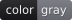
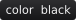
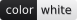
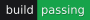
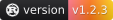
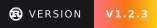
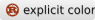
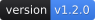

# badgelib

<div align="center">

[](https://crates.io/crates/badgelib)
[](https://docs.rs/badgelib)
[](https://crates.io/crates/badgelib)
[](https://github.com/vladkens/badgelib/blob/main/LICENSE)
[](https://buymeacoffee.com/vladkens)

</div>

`badgelib` is a Rust library for rendering customizable SVG badges directly in your application. Use it when you want to generate badges without running a separate badge service. It powers [badges.ws](https://badges.ws); the web service and its data integrations live in the main [badges repository](https://github.com/vladkens/badges).

## Used by

- [badges.ws](https://badges.ws) uses `badgelib` to power its hosted badge service.
- [Dagron](https://github.com/lucheeseng827/dagron) renders workflow status badges for its durable workflow engine.
- [Gradient](https://github.com/wavelens/gradient) renders task status badges for its self-hosted Nix CI.
- [ghstats](https://github.com/vladkens/ghstats) renders repository, portfolio, and service metrics as SVG badges.

Using `badgelib` in a public project? Send a pull request to add it to this list.

## Install

```sh
cargo add badgelib
```

## Quick start

```rust
use badgelib::{Badge, Color};

fn main() -> std::io::Result<()> {
  let svg = Badge::new()
    .label("build")
    .value("passing")
    .value_color(Color::Green)
    .radius(4)
    .to_svg();

  std::fs::write("badge.svg", svg)
}
```

`Badge::to_svg()` returns the complete SVG document as a `String`. Badges can include separate label and value colors, left-to-right gradients, a custom SVG icon, and a border radius.

SVG files embedded through `` are isolated from one another. Inserting multiple rendered SVG documents directly into the same DOM may cause their internal IDs to collide; if you need this use case, please open an issue or send a pull request for namespaced IDs.

## Colors

Choose a named color or pass a validated three- or six-digit hexadecimal value. The built-in colors retain the original palette's hues with enough depth for a consistent white foreground; `White` uses dark text instead.

```rust
use badgelib::{Badge, Color};

let svg = Badge::new()
  .label("color")
  .value("green")
  .value_color(Color::Green)
  .to_svg();
```

<!-- examples:colors:start -->
<p align="center">
  
  
  
  
  
  
  
  
  
  
</p>
<!-- examples:colors:end -->

## Styles

Badges use the rounded `Flat` style by default. Select `FlatSquare` for square corners and solid backgrounds without the subtle highlight used by `Flat`. Use `ForTheBadge` for a larger badge with uppercase text and a bold value:

```rust
use badgelib::{Badge, Style};

let svg = Badge::new()
  .label("build")
  .value("passing")
  .style(Style::ForTheBadge)
  .to_svg();
```

Use `radius` when you only want to override the corner radius. A custom radius does not change the selected style's background treatment.

<!-- examples:styles:start -->
<p align="center">
  
  
  
</p>
<!-- examples:styles:end -->

## Gradients

Pass two or more colors to distribute them evenly from left to right:

```rust
use badgelib::{Badge, Color};

let svg = Badge::new()
  .label("build")
  .value("passing")
  .value_gradient([Color::Red, Color::Orange, Color::Cyan])
  .to_svg();
```

Use `label_gradient` for the left side of a two-part badge. Calling a solid-color setter replaces the corresponding gradient, and calling a gradient setter replaces the solid color.

<!-- examples:gradients:start -->
<p align="center">
  
  
  
</p>
<!-- examples:gradients:end -->

<!-- examples:gradients-for-the-badge:start -->
<p align="center">
  
  
  
</p>
<!-- examples:gradients-for-the-badge:end -->

## Simple Icons

The bundled [Simple Icons](https://simpleicons.org) collection is opt-in so applications that do not use it avoid its compile-time and binary-size cost:

```sh
cargo add badgelib --features simple-icons
```

With the feature enabled, `logo` and `logo_color` select and customize a slug from the current collection, including slugs removed from supported historical releases. Standard Simple Icons follow the text color unless `logo_color` is set explicitly.

Lookups are case-insensitive. Spaces, hyphens, underscores, and `!` can be omitted; `.` and `+` also follow the Simple Icons `dot` and `plus` slug conventions, so names such as `GitHub Actions`, `C++`, and `.NET` work directly.

Without the feature, the named-logo builder methods are unavailable and incoming `logo` fields are ignored during deserialization. Custom SVG icons remain available.

```rust
use badgelib::{Badge, Color};

let svg = Badge::new()
  .value("built with Rust")
  .logo("rust")
  .logo_color(Color::White)
  .to_svg();
```

`logo` accepts unknown slugs and simply omits the image. Use `try_logo` when an unknown slug should be an error:

```rust
let badge = badgelib::Badge::new()
  .try_logo("rust")
  .expect("rust must be present in Simple Icons");
```

<!-- examples:simple-icons:start -->
<p align="center">
  
  
  
  
  
</p>
<!-- examples:simple-icons:end -->

## Custom icons

Custom SVG icons remain available without features. Use `icon_svg` for project-specific artwork or icons that require multiple colors or shapes. Pass only trusted markup: `badgelib` embeds custom SVG without sanitizing it.

```rust
use badgelib::Badge;

let svg = Badge::new()
  .value("custom icon")
  .icon_svg(r##"<svg xmlns="http://www.w3.org/2000/svg" viewBox="0 0 24 24">
    <path d="M12 3 L14 10 L21 12 L14 14 L12 21 L10 14 L3 12 L10 10 Z" fill="#facc15" />
  </svg>"##)
  .to_svg();
```

<!-- examples:custom-icons:start -->
<p align="center">
  
</p>
<!-- examples:custom-icons:end -->

## Animations

Select one opinionated animation with `animation`. Calling it again replaces the previous selection; speed, direction, easing, and target area are intentionally not configurable. All animations respect the viewer's reduced-motion preference.

`Animation::Flow` scrolls every configured gradient continuously. A gradient on only the label or value animates only that section; solid-color sections remain static.

```rust
use badgelib::{Animation, Badge, Color};

let svg = Badge::new()
  .value("flowing")
  .value_gradient([Color::Red, Color::Orange, Color::Cyan])
  .animation(Animation::Flow)
  .to_svg();
```

`Animation::Shine` periodically sweeps a soft diagonal light streak across the full width of the badge, including both label and value sections.

`Animation::Aurora` layers one continuous field of slowly drifting, softly blurred lights across the full badge. Its palette is derived from all existing label and value background colors.

```rust
let svg = Badge::new()
  .value("northern lights")
  .value_color(Color::Blue)
  .animation(Animation::Aurora)
  .to_svg();
```

<!-- examples:animations:start -->
<p align="center">
  
  
  
  
  
  
</p>
<!-- examples:animations:end -->

<!-- examples:animations-for-the-badge:start -->
<p align="center">
  
  
  
</p>
<!-- examples:animations-for-the-badge:end -->

## Built-in badge types

The library includes helpers for common badge values and their default formatting:

```rust
use badgelib::{Badge, Period};

let version = Badge::new().for_version("version", "1.2.0");
let license = Badge::new().for_license("MIT");
let downloads = Badge::new().for_downloads(Period::Month, 1_234_567);
let build = Badge::new().for_ci_status("build", true);
let size = Badge::new().for_size("size", 1_234_567);
let rating = Badge::new().for_rating("rating", 4.5, 5.0);
```

<!-- examples:built-ins:start -->
<p align="center">
  
  
  
  
  
  
</p>
<!-- examples:built-ins:end -->

Available helpers cover versions, licenses, downloads, CI status, counts, sizes, ratings, star ratings, and relative durations. You can override their labels and colors with the regular builder methods.

## JSON output

Use `Badge::to_json()` when you need the badge parameters as JSON instead of rendered SVG:

```rust
let json = badgelib::Badge::new()
  .label("version")
  .value("v1.2.0")
  .to_json();
```

```json
{
  "label": "version",
  "labelColor": null,
  "value": "v1.2.0",
  "color": null,
  "radius": null,
  "style": "flat"
}
```

`logo` and `logoColor` also appear when the `simple-icons` feature is enabled. `format` and `cache` appear when the `axum` feature is enabled.

## Axum integration

Enable the optional `axum` feature to return a `Badge` directly from a handler:

```sh
cargo add badgelib --features axum
```

```rust
use axum::{http::header, response::IntoResponse};
use badgelib::Badge;

async fn version_badge() -> impl IntoResponse {
  (
    [(header::CACHE_CONTROL, "public, max-age=60")],
    Badge::new().for_version("version", env!("CARGO_PKG_VERSION")),
  )
}
```

With this feature enabled, `Badge` implements Axum's `IntoResponse` and returns SVG by default with the appropriate content type and cache headers. Cache policy depends on the freshness of the underlying data, so configure it with regular Axum response headers as shown above or with route middleware; an outer header overrides the default emitted by `Badge`.

## WebAssembly

`badgelib` supports the `wasm32-unknown-unknown` target with its default configuration and with the optional `simple-icons` and `axum` features. It can be used from [workers-rs](https://github.com/cloudflare/workers-rs) applications on Cloudflare Workers and from other Rust WebAssembly hosts.

```sh
rustup target add wasm32-unknown-unknown
cargo build --release --target wasm32-unknown-unknown --all-features
```

The crate provides badge rendering rather than a Worker entrypoint, so the host application remains responsible for runtime bindings and deployment. The `axum` feature adds `IntoResponse` integration without enabling Axum's Tokio and HTTP server stack.

## Credits

- Inspired by [Shields.io](https://shields.io) and [Badgen](https://badgen.net).
- Icons are provided by [Simple Icons](https://simpleicons.org).
- Badge text is rendered with [DejaVu Sans](https://dejavu-fonts.github.io).

## License

Distributed under the [MIT License](LICENSE).
